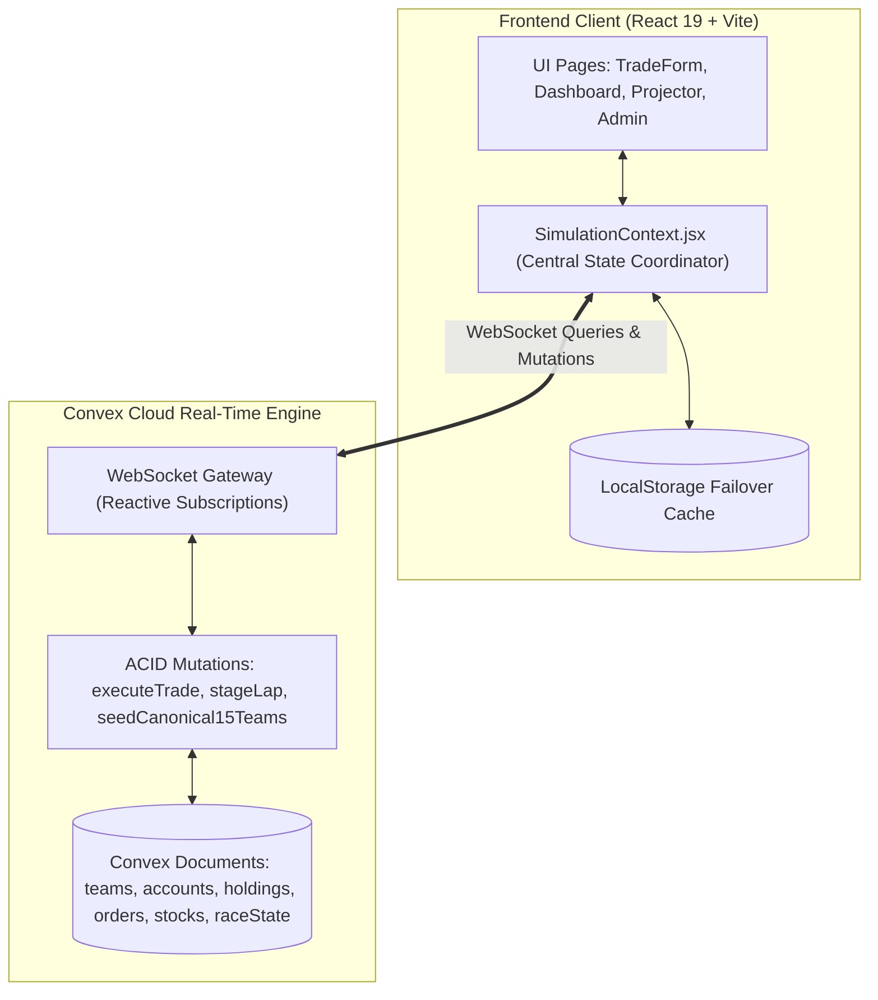

# Stock Market Simulator — System Architecture & Workflow

## 1. Project Overview & Tech Stack

| Layer | Technology | Repository File / Reference | Purpose & Status |
| :--- | :--- | :--- | :--- |
| **Frontend Framework** | React 19.2.8 | `package.json`, `src/App.jsx` | Single Page Application UI rendering (`IMPLEMENTED`) |
| **Build & Bundler** | Vite 8.2.2 + `@vitejs/plugin-react` | `vite.config.js` | Fast HMR dev server & production client bundling (`IMPLEMENTED`) |
| **Styling Engine** | Tailwind CSS v4 (`@tailwindcss/vite`) | `index.html`, `src/index.css` | Utility-first responsive dark motorsport styling (`IMPLEMENTED`) |
| **Backend & Database**| Convex Cloud v1.45.0 | `convex/schema.ts`, `convex/` | Serverless reactive backend, schema validation, ACID mutations (`IMPLEMENTED`) |
| **Real-Time Layer** | Convex WebSockets | `SimulationContext.jsx` | Sub-second bidirectional state synchronization (`IMPLEMENTED`) |
| **Routing & Motion** | React Router v7 & Motion 13.1 | `src/App.jsx` | Client navigation & telemetry UI transitions (`IMPLEMENTED`) |
| **Charts & Visuals** | HTML5 Canvas + Lucide Icons | `MiniSparklineCanvas.jsx` | Real-time lightweight performance sparklines (`IMPLEMENTED`) |
| **External Market API**| Twelve Data API | `convex/historical.ts`, `.env` | Historical 1-min OHLC candle data fetching (`PARTIAL`) |
| **Client PWA Engine** | `vite-plugin-pwa` 2.0.0 | `vite.config.js`, `dist/sw.js` | Service worker offline caching & manifest (`IMPLEMENTED`) |
| **Hosting & Target** | Vercel (Client) + Convex (Cloud) | `vercel.json` | Global SPA rewrites & serverless state hosting (`IMPLEMENTED`) |

---

## 2. Complete Workflow Lifecycle

```
[1. Admin Setup]       Admin configures starting capital (default ₹1,00,000), laps, event countdown, & grid status.
      │
[2. Team Seeding]      15 canonical teams & 30 credential accounts provisioned in Convex with PINs (1001-1015).
      │
[3. Authentication]    Leader/Member logs in via Team PIN / credentials; single active leader session enforced.
      │
[4. Flag-Off Start]    Admin transitions state from GRID_WARMUP -> GREEN_FLAG. Lap timer starts ticking down.
      │
[5. Market Movement]   Admin triggers macro sector shocks (+25%/-11%) or price nudges; live ticker broadcasts events.
      │
[6. Order Execution]   Leaders execute Buy/Sell orders via atomic Convex mutations. Cash and holdings updated.
      │
[7. Portfolio Telemetry]Holdings mark-to-market revalued in real time: Equity = Cash + Sum(Shares × Live Price).
      │
[8. Live Standings]    Auditorium Projector & Leaderboard rank teams by net portfolio value (tie-break: return %).
      │
[9. Checkered Flag]    Admin triggers CHECKERED_FLAG. Market freeze locks trading, declaring final winners.
```

---

## 3. Team Management & 15-Team Grid

The simulation strictly provisions **15 fixed teams** (`CANONICAL_15_TEAMS` in `src/data/teams.js` & `convex/teams.ts`):

| Slot | Code | Team Name | Default PIN | Leader User | Member User | Role Permissions |
| :---: | :---: | :--- | :---: | :---: | :---: | :--- |
| **#1** | `ALPHA-01` | **Bull Titans** | `1001` | `alpha_leader` | `alpha_member` | **Leader:** Full Buy/Sell order execution |
| **#2** | `BRAVO-02` | **Market Mavericks** | `1002` | `bravo_leader` | `bravo_member` | **Member:** View-only telemetry & charts |
| **#3** | `CHARLIE-03` | **The Alpha Traders** | `1003` | `charlie_leader` | `charlie_member` | **Roster:** Exactly 3 named members per team |
| **#4** | `DELTA-04` | **Bull Run Legends** | `1004` | `delta_leader` | `delta_member` | **Session Guard:** Single active leader session |
| **#5** | `ECHO-05` | **Nifty Ninjas** | `1005` | `echo_leader` | `echo_member` | **PIN Auth:** 4-digit code (`1001`–`1015`) |
| **#6** | `FOXTROT-06` | **Wall Street Wolves** | `1006` | `foxtrot_leader` | `foxtrot_member` | **Admin Monitoring:** Live presence dot |
| **#7** | `GALAXY-07` | **Profit Predators** | `1007` | `galaxy_leader` | `galaxy_member` | **Session Reset:** Admin can unlock sessions |
| **#8** | `HORIZON-08` | **The Stock Sharks** | `1008` | `horizon_leader` | `horizon_member` | **Disqualification:** Admin can disable trading |
| **#9** | `INFINITY-09`| **Capital Commanders**| `1009` | `infinity_leader`| `infinity_member`| **Cash Edit:** Admin can override capital balance |
| **#10**| `JAGUAR-10` | **Portfolio Panthers** | `1010` | `jaguar_leader` | `jaguar_member` | **Password Reset:** Admin can re-key team PIN |
| **#11**| `KNIGHT-11` | **The Equity Eagles** | `1011` | `knight_leader` | `knight_member` | **Telemetry Sync:** Real-time holding ledger |
| **#12**| `LEGENDS-12`| **Market Monarchs** | `1012` | `legends_leader`| `legends_member`| **Audit Record:** Order executedBy tagged |
| **#13**| `MAVERICKS-13`| **Bear & Bull Brigade**| `1013` | `mavericks_leader`|`mavericks_member`| **Anti-Cheating:** Role mismatch blocked |
| **#14**| `NOVA-14` | **The Wealth Warriors**| `1014` | `nova_leader` | `nova_member` | **Failover:** LocalStorage state caching |
| **#15**| `PHOENIX-15`| **TradeStorm** | `1015` | `phoenix_leader`| `phoenix_member`| **Credentials:** Exportable to CSV / clipboard |

*Security Risks Identified:* Team default PINs (`1001`–`1015`) are sequential and predictable (`PARTIAL`). Admin console key is exposed in client env `VITE_ADMIN_KEY` (`PARTIAL`). Single active session is checked by `sessionId` string matching in Convex mutation.

---

## 4. Market Simulation Engine

- **Price Determination:** Equities in `convex/market.ts` (17 stocks across 5 sectors) are **fully simulated** inside the platform. They are **not** real-time exchange feeds.
- **Price Shock Mechanism:** Admin broadcasts sector shocks (`adminTriggerSectorShock`) affecting stock prices by designated percentage multipliers (e.g. +12% solid-state EV surge, -10% raw lithium shortage).
- **External API vs Simulation:** Twelve Data API (`convex/historical.ts`) is integrated to fetch static historical 1-minute OHLC candles for background chart reference (`PARTIAL`), but all live in-competition trades execute against internal database values (`currentPrice`).
- **Recommended Architecture:** Implement an automated cron or serverless tick runner (e.g. Geometric Brownian Motion with mean-reversion) to update stock prices automatically per tick, removing total reliance on manual admin intervention.

---

## 5. Financial Calculations & Accounting

The default starting capital is **₹1,00,000** per team (`raceState.defaultStartingCapital`), modifiable before flag-off.

### Core Mathematical Formulas
1. $\text{Purchase Cost} = (\text{Quantity} \times \text{Execution Price}) + \text{Fees}$ *(Note: Current `fees = 0`)*
2. $\text{Sale Proceeds} = (\text{Quantity Sold} \times \text{Execution Price}) - \text{Fees}$
3. $\text{Holding Market Value} = \text{Quantity Owned} \times \text{Current Market Price}$
4. $\text{Portfolio Equity} = \text{Available Cash} + \sum (\text{Holding Market Value})$
5. $\text{Total P\&L} = \text{Portfolio Equity} - \text{Initial Starting Capital}$
6. $\text{Return \%} = \left(\frac{\text{Total P\&L}}{\text{Initial Starting Capital}}\right) \times 100$
7. $\text{Realized P\&L} = \text{Net Sale Proceeds} - (\text{Quantity Sold} \times \text{Weighted Average Buy Price})$
8. $\text{Unrealized P\&L} = \text{Current Holding Market Value} - \text{Remaining Cost Basis}$

### Short Numerical Example
- **Step 1 (Buy):** Cash = ₹1,00,000. Buy 50 shares of `APEX` at ₹800. Cost = ₹40,000. Cash remaining = ₹60,000. Cost Basis = ₹800/share.
- **Step 2 (Price Surge):** `APEX` moves to ₹900. Holding Value = 50 × ₹900 = ₹45,000. Equity = ₹60,000 + ₹45,000 = ₹1,05,000. Unrealized P&L = +₹5,000 (+5.0%).
- **Step 3 (Sell):** Sell 20 shares at ₹900. Sale Proceeds = ₹18,000. Cash becomes ₹78,000. Realized P&L = 20 × (900 − 800) = +₹2,000. Remaining: 30 shares at ₹800 cost basis.

*Accounting Note:* Calculations currently round to 2 decimals using standard JavaScript floats (`Math.round(... * 100) / 100`). It is strongly **recommended** to migrate balances to **integer paise** (`10000000` paise = ₹1,00,000) to eliminate floating-point precision drift.

---

## 6. Architecture & Data Flow



---

## 7. Security & Operating Constraints

- **Role Authorization (`IMPLEMENTED`):** Leader-only execution verified in `convex/trades.ts`. Members receive `View Only Mode` errors upon trade attempt.
- **Cash & Holding Validation (`IMPLEMENTED`):** Trade rejects with `Insufficient cash` if order amount > `cashBalance`. Short selling is blocked (`Short selling is not permitted. You attempted to sell X but own Y`).
- **Concurrency & Atomicity (`IMPLEMENTED`):** Convex transactions are strictly serialized and ACID compliant. Two simultaneous orders cannot double-spend cash.
- **Race State Interlocks (`IMPLEMENTED`):** Trading blocked during `GRID_WARMUP`, `SAFETY_CAR` (Yellow Flag), and `CHECKERED_FLAG`.
- **Session Locking (`IMPLEMENTED`):** Leader account has an `activeLeaderSessionId` lock preventing simultaneous multi-tab leader logins.

---

## 8. Leaderboard & Scoring Engine

- **Primary Ranking Metric (`IMPLEMENTED`):** Sorted strictly descending by **Total Portfolio Equity** (`totalPortfolioValue = cashBalance + holdingsValue`), never cash alone (`convex/leaderboard.ts:123`, `src/pages/Projector.jsx:189`).
- **Tie-Breaking Rule (`IMPLEMENTED`):** If portfolio equity is equal, secondary sort uses highest `returnPercent`.
- **Auditorium Projector (`IMPLEMENTED`):** Dedicated large-screen display (`/projector`) highlighting P1/P2/P3 podium with gold/silver/bronze crowns, real-time returns, and active stock counts.
- **50/30/20 Formula (`PARTIAL`):** Platform computes alternative 50% return + 30% sector diversification + 20% capital deployment score, but auditorium rankings default to pure Portfolio Value.

---

## 9. Deployment, Configuration & Testing

### Environment Variables
- `CONVEX_DEPLOYMENT`: Convex project deployment tag (e.g. `dev:dynamic-perch-349`).
- `VITE_CONVEX_URL`: Public WebSocket endpoint for frontend React clients.
- `VITE_CONVEX_SITE_URL`: HTTP endpoint for Convex HTTP actions.
- `ADMIN_KEY` / `VITE_ADMIN_KEY`: Shared secret key for director authentication.
- `TWELVE_DATA_API_KEY`: API key for external market candles in `convex/historical.ts`.

### Verified Operational Commands
- `npm run dev`: Launch Vite development server on `http://localhost:5173`.
- `npm run build`: Production bundle verification with PWA service worker generation.
- `npx convex dev`: Push schema and server functions to active Convex Cloud deployment.

---

## 10. Known Gaps & Action Items

| Priority | Issue Description | Location | Recommended Remedy |
| :---: | :--- | :--- | :--- |
| **HIGH** | **Client-Exposed Admin Secret** | `src/context/SimulationContext.jsx:32` | Move director auth to backend Convex session cookie; eliminate `VITE_ADMIN_KEY`. |
| **MEDIUM** | **Floating Point Currency Rounding** | `convex/trades.ts:152`, `trades.ts:165` | Store all balances as integer paise (`₹1.00 = 100 paise`) to prevent fractional float errors. |
| **MEDIUM** | **Manual Price Engine Dependency** | `convex/market.ts:417` | Add a background scheduled cron runner (`crons.ts`) to tick market prices automatically per minute. |
| **LOW** | **Predictable Sequential PINs** | `src/data/teams.js:7-21` | Generate cryptographically random 4-digit PINs per competition event in admin seeding modal. |
